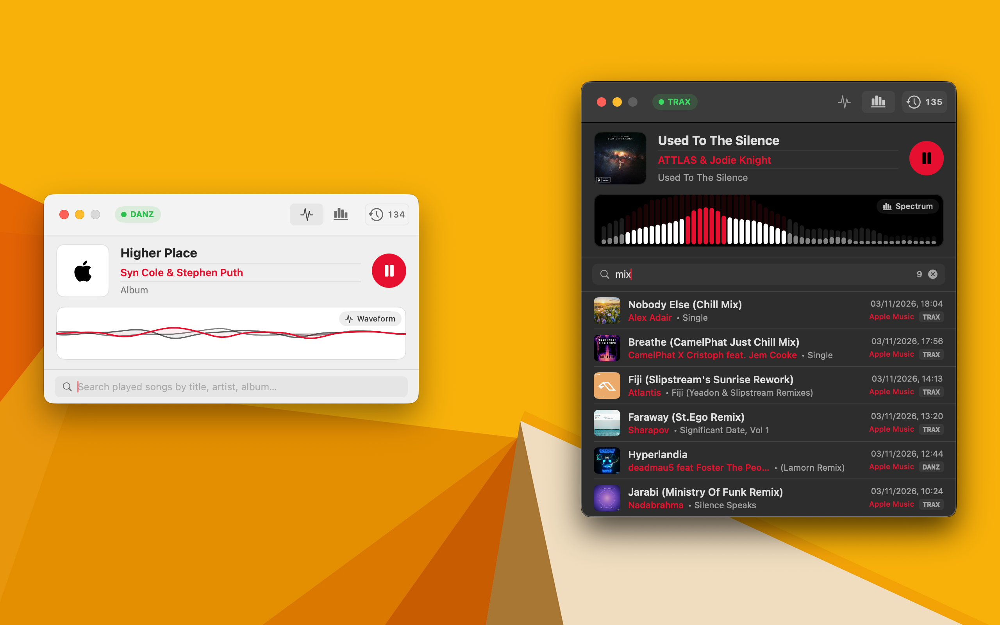

# Chilltrax — Winamp of the AI era



Chilltrax is a native macOS radio player built with SwiftUI and AVFoundation for **Chilltrax — The World's Chillout Channel** (`chilltrax.com`) and its sister station **Radio Danz — The World's Pure Dance Channel** (`radiodanz.com`).

## Specification & Requirements

1. **Native macOS Application**:
   - Built with Swift Package Manager targeting **macOS 14+ (Sonoma)** using SwiftUI and AppKit window customization (`titleVisibility = .hidden`, `.unified` toolbar, `.fullSizeContentView`), matching `macreply` and `macnews`.
2. **Chilltrax & Radio Danz Station Switching and Broadcast Discovery**:
   - **Switch Between Chilltrax & Radio Danz**: Allows switching between **Chilltrax** (`TRAX`, default) and **Radio Danz** (`DANZ`) in Settings.
   - **Find Broadcasts**: Queries and parses both `https://www.chilltrax.com` and `https://www.radiodanz.com` in Settings to discover official broadcast streams and API URL changes (`GetSongInformationNew.php`, `GetCoverImageNew.php`, `GetLastTenNew.php`), resolving `.pls` and redirect endpoints automatically.
3. **Real-Time Audio Visualizer (Waveform or Spectrum)**:
   - Interactive visualizer supporting both **Waveform** and **Spectrum** modes, switchable directly from the player or Settings.
4. **Playback Controls & Current Song Display**:
   - Play / Pause toggle (plays at maximum volume `1.0` so system volume controls audio level), left-aligned toolbar station status badge (`READY` / `TRAX` or `DANZ` / `PAUSED` / `LOADING` / `ERROR`) that switches between Chilltrax and Radio Danz when `TRAX` or `DANZ` is clicked and opens the Settings panel for other statuses, current song title, artist, album/mix badge, and album cover.
5. **Album Cover Fetching & Local Cover Cache**:
   - Global toggle ("Display and fetch album covers") to enable or disable displaying and fetching album artwork for the currently playing song and history entries while keeping already-fetched covers cached locally on disk (`~/Library/Application Support/Chilltrax/Covers`) until history is cleared.
6. **macOS Notifications on Song Change**:
   - Sends native macOS notifications (`UNUserNotificationCenter`) whenever the playing track changes, displaying the new song title, artist, and album/mix (configurable in Settings).
7. **Compact Player Main UI with Expandable Searchable History (`TRAX` / `DANZ` Labels)**:
   - Main UI is a sleek **compact player** window with a full-width visualizer across the bottom.
   - Clicking the **History SF Symbol** (`clock.arrow.circlepath`) with the live song counter in the toolbar smoothly expands the window to reveal a **searchable history list** of all played songs (filterable by title, artist, album/mix, or station), with each song marked with a 4-character `TRAX` or `DANZ` badge.
8. **Compressed Local Song History Persistence**:
   - Every song played for at least the configured duration (0–99 seconds, default 10 seconds) is persisted locally across app restarts in an **efficiently compressed text file** (`~/Library/Application Support/Chilltrax/history.tsv.lzfse`), using tab-separated UTF-8 text compressed with Apple's native `Compression` (`LZFSE`) algorithm (matching `monochrome`).

## Implementation Tracker

- [x] Project scaffolding (`Package.swift`, `Makefile`, `white.svg`, `black.svg`, `AppIcon.icns`)
- [x] Models (`StationStream`, `SongMetadata`, `SongHistoryEntry`, `VisualizerMode`)
- [x] Compressed text file history persistence (`CompressedHistoryStore` using `LZFSE`-compressed TSV text)
- [x] Chilltrax website stream discovery & live metadata/cover client (`ChilltraxClient`)
- [x] Audio stream player (`AVPlayer` + ICY `AVPlayerItemMetadataOutput` + `.pls` resolver + visualizer engine + `UNUserNotificationCenter` notifications)
- [x] Compact player UI with Waveform / Spectrum visualizer & album cover art (`CompactPlayerView`, `VisualizerView`)
- [x] Expandable searchable song history view toggled via SF Symbol (`HistoryListView`)
- [x] Settings window for discovering `chilltrax.com` broadcasts, custom stream URLs, visualizer mode, notifications, and album cover fetching (`SettingsView`)
- [x] Unit test suite (`Tests/ChilltraxTests/ChilltraxTests.swift`)

## Building & Running

### Build & Launch `.app` Bundle

```bash
make app
make run
```

### Run via SwiftPM CLI

```bash
swift run
```

### Run Unit Tests

```bash
swift test
```
